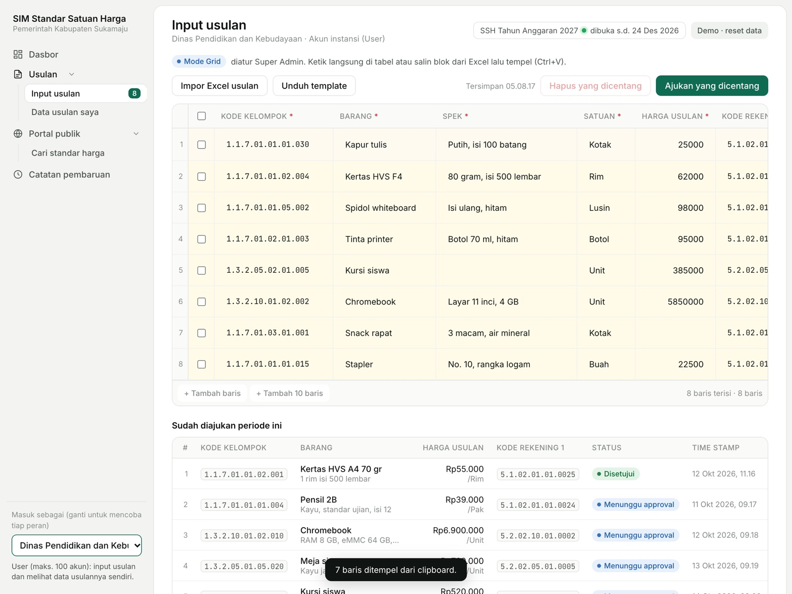
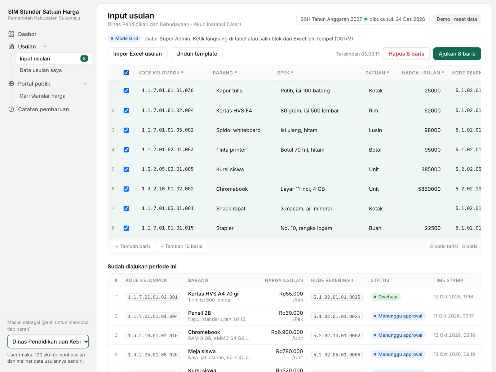
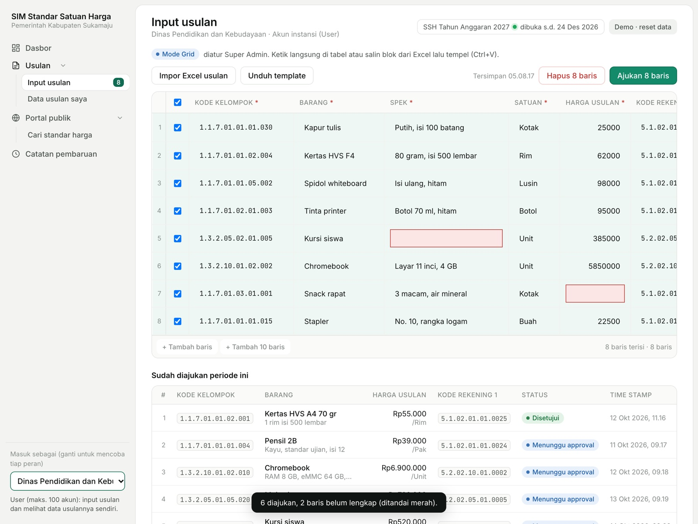
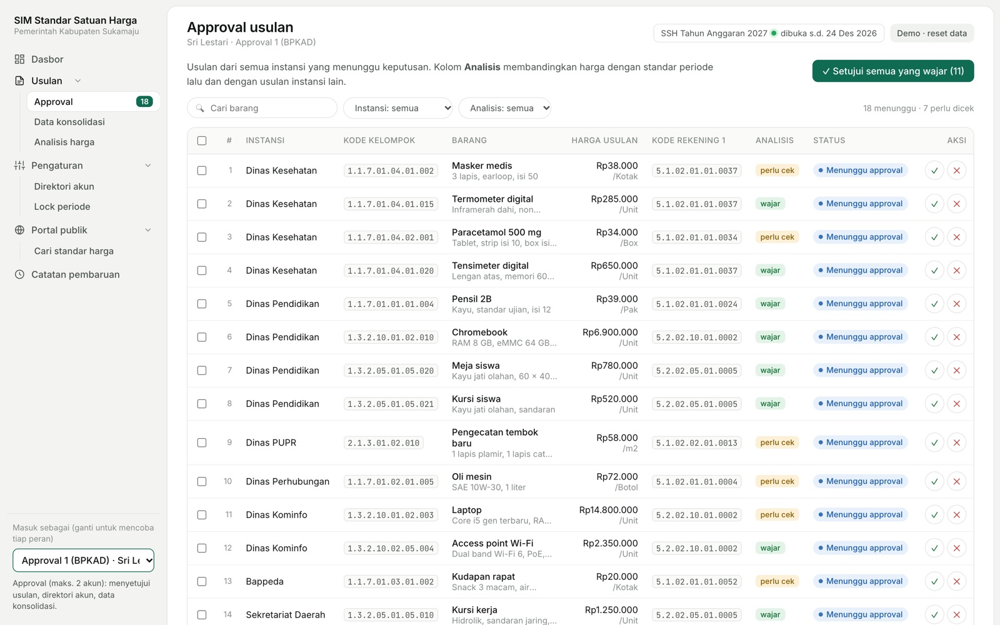
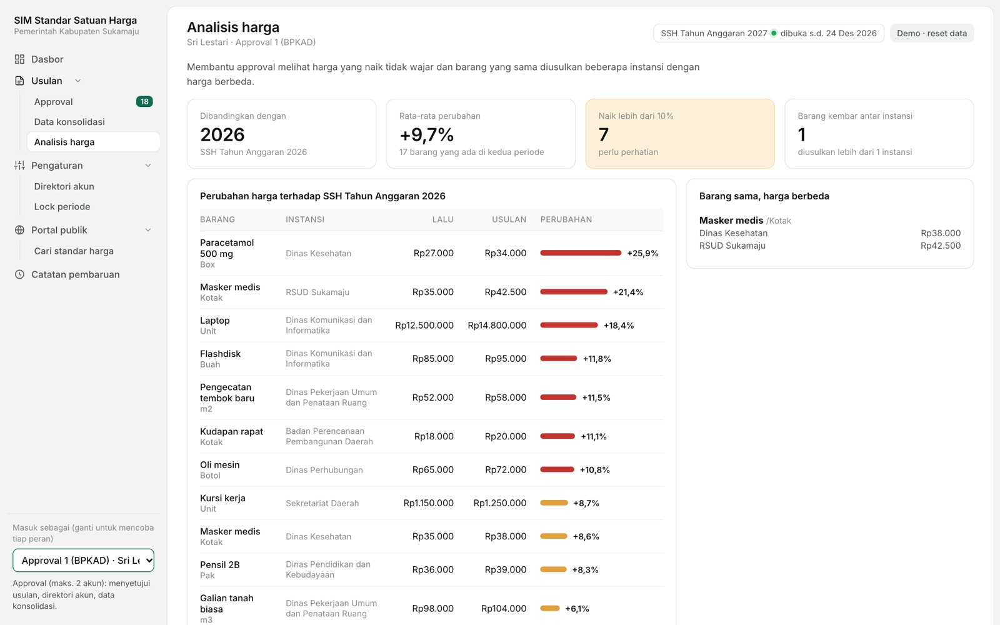
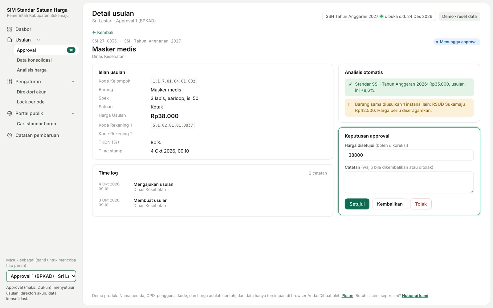
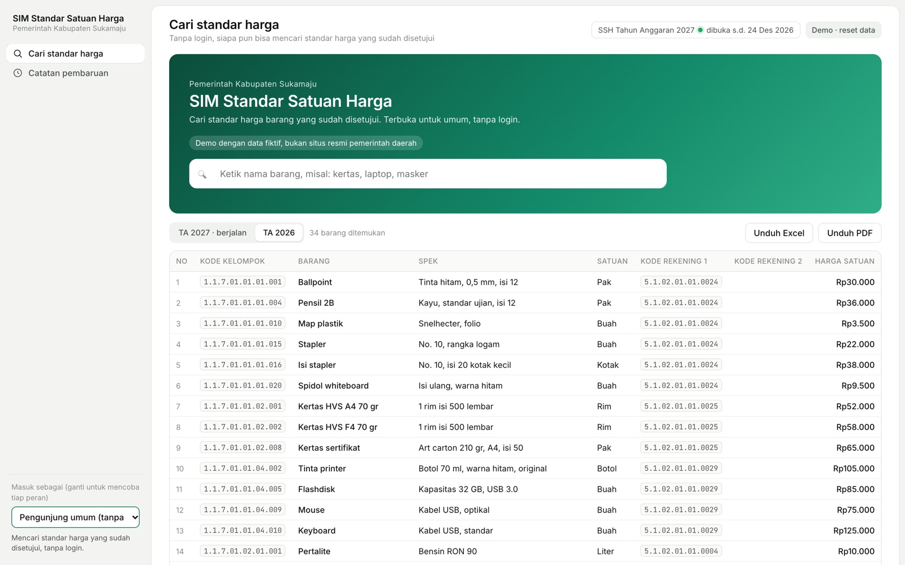

# SIM Standar Satuan Harga (demo)

Demo aplikasi usulan dan persetujuan harga dengan **grid ala Excel**. Cocok untuk tim yang datanya masih di Excel
atau spreadsheet dan ingin pindah ke sistem tanpa mengubah cara kerja. Contoh kasusnya Standar Satuan Harga (SSH)
pemerintah daerah.

**Coba langsung:** https://standarharga.pluton.id · **Studi kasus:** https://pluton.id/id/work/standar-satuan-harga



## Grid

- Salin blok dari Excel atau Google Sheets, tempel di sel mana saja. Baris bertambah otomatis sesuai jumlah data.
- Setiap sel tersimpan sendiri sebagai draf, tanpa tombol simpan.
- Centang banyak baris untuk diajukan atau dihapus sekaligus. Penghapusan bisa diurungkan.
- Sel wajib yang kosong ditandai merah saat diajukan. Baris yang lengkap tetap terkirim.
- Impor file Excel dengan template, ekspor lagi ke Excel kapan saja.

| Pilih banyak baris | Validasi saat diajukan |
|---|---|
|  |  |

## Fitur lain

Ganti peran lewat pilihan "Masuk sebagai" di kiri bawah.

- **Approval**: setujui (dengan koreksi harga), kembalikan, atau tolak; setujui massal yang wajar
- **Analisis harga**: kenaikan terhadap periode lalu, dan barang sama dengan harga berbeda antar instansi
- **Super Admin**: pilih metode input (grid atau formulir), atur kolom, halaman depan, cadangan dan pemulihan data
- **Publik**: cari standar harga per tahun anggaran, unduh Excel atau lampiran PDF A4

| Approval | Analisis harga |
|---|---|
|  |  |
| **Detail usulan** | **Portal publik** |
|  |  |

Alur lengkapnya ada di [docs/flowchart-sim-ssh.png](docs/flowchart-sim-ssh.png).

## Batasannya

Ini demo antarmuka, bukan sistem produksi: tidak ada backend dan tidak ada login sungguhan. Data disimpan di
localStorage browser. Nama pemda, OPD, kode, dan harga semuanya fiktif, dan kode barang/rekening hanya ilustrasi.

## Menjalankan sendiri

```
cd app && python3 -m http.server 8765
```

Vanilla JS tanpa langkah build, SheetJS untuk Excel, print CSS untuk lampiran PDF. `worker/` dan `wrangler.toml`
untuk menyajikannya lewat Cloudflare Workers (ganti domain di `wrangler.toml`).

## Lisensi

Hak cipta 2026 PT DIGITAL DUNIA AKHIRAT (Pluton). Kode boleh dibaca dan dijalankan sendiri untuk dicoba. Untuk dipakai
di organisasi atau dikembangkan menjadi produk, hubungi kami dulu: hello@pluton.id. Lihat [LICENSE](LICENSE).
